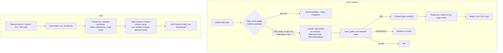
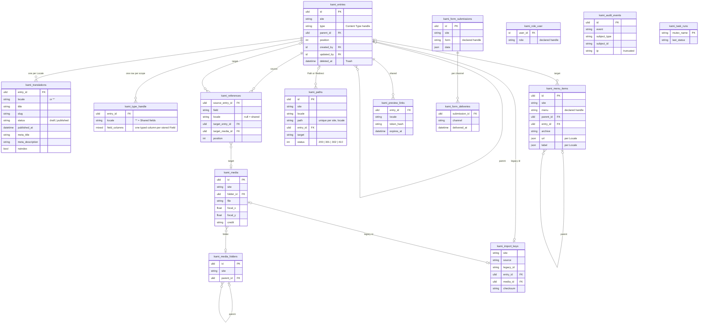

# Kami architecture

What Kami is made of and why, readable in one hour. Every decision here was taken in the wayfinder map ([Wayfinder: architecture and milestone roadmap](https://github.com/psyao/kami/issues/1)); this document restates them for use and adds none. The details live in `docs/adr/` (linked, never copied), the vocabulary in `GLOSSARY.md`, the plan in `docs/roadmap.md`. Steve's sources are `docs/brief.md` and `docs/comparatif-cms.md`.

## Key decisions

Each line can be accepted or contested on its own. The link gives the reasons.

1. **Package plus starter kit.** One Composer package, `psyao/kami`, always a Filament plugin added to the host's panel, never a panel of its own; a starter kit, `psyao/kami-starter`, holds only the wiring of a new site and belongs to the site once created. Nothing global without the host's opt-in, every table prefixed `kami_`. ([ADR 0001](adr/0001-package-plus-starter-kit.md))
2. **One install command.** `kami:install` is idempotent and serves both the first install and every deploy; there is no `kami:upgrade`. ([ADR 0001](adr/0001-package-plus-starter-kit.md))
3. **Everything is an Entry.** Every content item, in all its Locales, has one row in `kami_entries`; Terms, Singletons, Global Sets and the site settings are Entries too. Media are a separate entity. ([ADR 0002](adr/0002-every-content-item-is-an-entry.md))
4. **ULID keys** on every `kami_` table; Users keep the host's key type. ([ADR 0003](adr/0003-ulid-primary-keys.md))
5. **Multisite-ready schema, Sites in code.** Sites are declared in `config/kami.php`; site-scoped rows carry a `site` handle. One Site per install in the MVP. ([ADR 0004](adr/0004-sites-declared-in-code.md))
6. **One References table** with two real foreign keys (Entry, Media), no morph pair. ([ADR 0005](adr/0005-one-references-table-with-real-foreign-keys.md))
7. **Typed table per Content Type.** Field values live in `kami_type_<handle>`, one row per scope (`'*'` for Shared fields, one per Locale for Translatable ones), changed through ordinary migrations; drift fails the deploy, and `kami:make:migration` alone scans a `json` column that SQLite or MariaDB reports under another type. ([ADR 0006](adr/0006-field-values-in-a-table-per-content-type.md))
8. **Content Types are classes.** One `final` class per type with `fields()`, layout and declarative conditions in the core; Filament is reached only through site-owned `EntryForm` / `EntryTable` subclasses. ([ADR 0007](adr/0007-content-types-declared-as-classes-filament-through-site-forms.md))
9. **One paths table.** Current Paths and Redirects share `kami_paths`, unique per `(site, locale, path)`; resolution is one indexed read and Redirects never chain. ([ADR 0008](adr/0008-one-paths-table-for-urls-and-redirects.md))
10. **Rendering through a hook.** `ContentType::render()` turns an Entry into any response; views are the site's, Kami ships accessible `x-kami::` components and no CSS. No Livewire on the public front. ([ADR 0009](adr/0009-entries-render-through-a-content-type-hook.md))
11. **Narrow public API.** Internals in `Internal` namespaces, `final` by default, public surface snapshotted, schema internal. ([ADR 0010](adr/0010-internal-namespaces-and-public-surface-snapshot.md))
12. **Filament stays in `Admin`; writes go through core actions.** An architecture test enforces the boundary; actions trust their caller and authorization sits at each boundary. ([ADR 0011](adr/0011-filament-confined-to-admin-and-writes-through-core-actions.md))
13. **Unpublished content is hidden by default** from every read of the public models. ([ADR 0012](adr/0012-unpublished-content-hidden-by-default.md))
14. **Translations own per-Locale state**, and a blank Translatable field falls back one hop to the default Locale, from published content only, with its `lang`. ([ADR 0013](adr/0013-translations-own-per-locale-state-with-field-fallback.md))
15. **Roles in code, checks on Permissions**, through native Gates and Policies; no spatie/permission, no Shield. ([ADR 0014](adr/0014-roles-in-code-checks-on-permissions.md))
16. **Publication is read-time state** (`status` + `published_at <= now()`) on Translations, with no working copy in the MVP. ([ADR 0019](adr/0019-publication-is-read-time-state-on-translations.md))
17. **Rich text is Kami's TipTap document**, normalised against an allow-list on write; everything non-text is a Block. ([ADR 0016](adr/0016-rich-text-is-a-kami-document-normalised-on-write.md))
18. **Image Conversions on first request**, from named presets, written as static files that Apache serves afterwards. ([ADR 0017](adr/0017-conversions-generated-on-first-request.md))
19. **Page cache before boot**, invalidated by one Content version. ([ADR 0021](adr/0021-page-cache-served-before-boot-invalidated-by-one-content-version.md))
20. **One Tick runs overdue tasks in-process**, started by cron, a secret URL or visits; the `database` queue is drained within the Tick's budget. ([ADR 0020](adr/0020-overdue-tasks-run-in-process-from-one-tick.md))
21. **Front forms carry no session**: origin check, honeypot and throttle instead of a CSRF token. ([ADR 0015](adr/0015-front-forms-carry-no-session.md))
22. **Strict, nonce-free front CSP** owned by Kami; the admin gets Filament's minimum. ([ADR 0018](adr/0018-strict-nonce-free-front-csp-filament-minimum-in-the-admin.md))
23. **Audit log in a Kami table**, written by the core actions, IPs truncated. ([ADR 0022](adr/0022-audit-log-is-a-kami-table-written-by-core-actions.md))
24. **One Filament major per Kami major, no third-party Filament plugin.** ([ADR 0023](adr/0023-one-filament-major-per-kami-major-no-third-party-plugins.md)) Blocks reach the editor through a pool of 64 slot classes. ([ADR 0024](adr/0024-blocks-reach-filament-through-a-pool-of-slot-classes.md))
25. **Menus declared in code**, one tree per Site across Locales. ([ADR 0025](adr/0025-menus-declared-in-code-one-tree-per-site.md))
26. **Replayable imports** through legacy ids; the source wins until Switch-over. ([ADR 0026](adr/0026-imports-replay-through-legacy-ids-source-wins.md))
27. **Robots and sitemap are static files**, behind one indexable switch. ([ADR 0027](adr/0027-robots-and-sitemap-are-static-files-with-one-indexable-switch.md))
28. **Sites extend through events after commit**, never filters. ([ADR 0029](adr/0029-sites-extend-through-events-after-commit-never-filters.md))
29. **Public repositories, full CI matrix on every pull request.** ([ADR 0031](adr/0031-public-repository-full-ci-matrix-on-every-pull-request.md))
30. **MIT for good**, no CLA. ([ADR 0034](adr/0034-mit-licence-held-for-good.md))
31. **Package migrations append-only** from the first production install, squashed only in a major under an Upgrade floor. ([ADR 0035](adr/0035-package-migrations-append-only-squashed-only-in-a-major.md))
32. **Host applications may mount Kami pages in their session**, and Kami never shadows a host route. ([ADR 0038](adr/0038-host-applications-may-mount-kami-pages-in-their-session.md))
33. **Supported platforms.** PHP `^8.5`, Laravel `^13.32`, Filament `^5.10` (the lowest versions the test tooling resolves, so the Lowest job tests the declared floor; 5.10 is the first to put the CSP nonce on its inline scripts, ADR 0018); MariaDB 10.11, MySQL 8.4, PostgreSQL 15, SQLite 3.35. Releases by release-please, one per milestone in 0.x; 1.0 once the three sites run on one 0.x for 30 days without a break. ([Release policy and licence](https://github.com/psyao/kami/issues/30#issuecomment-6426631878))

## Vision and principles

Kami is a Laravel + Filament CMS for developers first. The developer models the site in code (Content Types, Fields, Blocks) and hands editors an admin cut to the site, with nothing superfluous: the approach of Statamic or Craft, not WordPress. Kami is a product, not a site. It ships as a package that a starter kit wires into a new site, and that an existing Laravel application can take in for its editorial pages without giving up its routes, users, panel or models.

Kami succeeds Velox, which runs aguet.dev in production. It is a deliberate rewrite: Velox is evidence, never a default, and the departures are listed below.

The MVP is done when **aguet.dev, psyao.ch and steve-et-aline.ch run in production on Kami**. Infomaniak shared hosting is a first-class target, not a degraded mode. There is no persistent process, no real cron, no Redis, no OPcache and no `exec` on the web, and nothing visitors see may wait on a scheduler.

Principles, ranked; the higher wins a conflict, and each ADR that trades one for another names both (definitions in `docs/brief.md`):

1. **Security by default.** A fresh install is safe with no configuration, and every weakening option is off and documented.
2. **Privacy by design.** No non-essential cookie, no tracking, bounded retention.
3. **Data sovereignty.** No third-party service by default: no CDN, remote font or telemetry.
4. **Accessibility.** WCAG 2.2 AA for the admin and for Kami's components.
5. **Stability.** Strict SemVer from 1.0, narrow public API, non-destructive migrations.
6. **Simplicity.** Conventions plus code over option screens; a few readable lines to declare a type.
7. **Performance.** A constant number of queries per page and a page cache that skips the boot. Measured, not assumed.
8. **Laravel-native.** What Laravel and Filament provide comes first, and every third-party package is justified.

Anti-goals: WordPress-style plugin hell, a mid-life licence change, endless configuration, dependence on a remote service, a project abandoned half-built.

### Departures from Velox

| Velox | Kami | Why |
| --- | --- | --- |
| Field values in a JSON `data` column | A typed table per Content Type | Filter and sort at 1 M Entries on three engines; loss always goes through a reviewed migration (ADR 0006) |
| A Translation is an Entry with `origin_id` | One Entry spans its Locales; per-Locale state in `kami_translations` | Menus, References and Redirects target one row; no copied Shared values (ADRs 0002, 0013) |
| Terms and Global Sets in tables of their own | Entries | A Term needs everything an Entry has (ADR 0002) |
| Path on the Entry, Redirects in a second table | One `kami_paths` table | Uniqueness and "never both live and redirected" held by the database (ADR 0008) |
| Private VCS repository | Public Packagist, public repositories | No Composer token on a shared host; unmetered CI (ADRs 0001, 0031) |
| Public API = what `docs/` names | `Internal` namespaces and a surface snapshot | 98 classes were public by accident (ADR 0010) |
| Image variants generated at upload | Conversions on first request | Upload stays cheap; no regeneration of the library (ADR 0017) |
| Images as rich-text nodes, unknown Blocks dropped | Images are Blocks, unknown Blocks kept | No JS build for the editor; no silent loss (ADR 0016) |
| CSP as a documented recipe | Headers owned by Kami | Only the code that renders the HTML can write a strict policy (ADR 0018) |
| Dynamic `/robots.txt` | Static file managed by `kami:install` | Infomaniak answers a missing file itself (ADR 0027) |
| Migrations squashed three times in 0.x | Append-only from the first production install | Three production sites on 0.x (ADR 0035) |
| Tree plugin for hierarchy | Filament's native `reorderable()` | Stability over editing comfort (ADR 0023) |

## Shape of the system

### Repositories

| Repository | Holds | Licence |
| --- | --- | --- |
| `psyao/kami` | The package: core, admin layer, migrations, translations, precompiled admin assets, `docs/guide/`, `docs/reference/`, `docs/adr/` | MIT |
| `psyao/kami-starter` | Wiring only: `AdminPanelProvider`, `User`, the `Kami::routes()` call, starter theme (Vite + Tailwind 4, no Alpine, no web font), `.htaccess`, error pages, example type, CI asset build | MIT |
| `psyao/kami-playground` | A long-lived private site created from the starter kit, updated locally at the end of every milestone and deployed to a non-indexable Infomaniak staging subdomain for M1, rendering milestones and switch-overs | Private |

Each reference site keeps its own private repository; its content and URL inventories never enter Kami's.

### Code layout

The package follows the Filament plugin skeleton (`src/`, `config/kami.php`, `database/`, `resources/dist/`, `stubs/`, `tests/`). `src/` is organised by domain module under `Psyao\Kami\`: `Content`, `Sites`, `Media`, `Routing`, `Menus`, `Seo`, `Forms`, `Users`, `Import`, with `Support` for cross-cutting code and `Admin` for everything Filament. Three boundaries are enforced by architecture tests:

- **Core and admin.** Only `Psyao\Kami\Admin` may use `Filament\`. `KamiServiceProvider` registers the core; `KamiPlugin` registers the admin. A Filament major touches `Admin` only (ADR 0011).
- **Public and internal.** Each module keeps its internals in an `Internal` sub-namespace marked `@internal`. Every other class is public, `final` unless it is on the closed allow-list of open classes, and recorded in `tests/Kami/PublicSurfaceTest.php` (ADRs 0010, 0029).
- **Imports.** No module depends on `Psyao\Kami\Import` (ADR 0026).

A site uses four kinds of public API: declarations (Content Types, Fields, Blocks, Forms, Image Presets, all listed in `config/kami.php`), the public models and their scopes (`Entry`, `Term`, `Media`, `Redirect`) for reads, the core actions (`SaveEntry`, `SaveMedia`, `SaveRedirect`, `SaveMenuItem`…) for writes, and Content events for reactions. Commands follow `kami:<verb>`, `kami:<area>:<verb>` and `kami:make:<thing>`, 20 in the MVP.

### Request and write paths



## Domain model

Sites, Locales, Content Types, Menus, Roles, Forms and Image Presets are declared in code. Rows carry their handles as strings (`site`, `type`, `menu`, `role`), with no table behind them. Everything below is a table. Users belong to the host application.



Columns are indicative; the migrations are the truth and the schema is internal (ADR 0010). Rules the diagram cannot show:

- **An Entry is one content item in every Locale.** It is visible in a Locale only through a published Translation there; a Content Type declared untranslatable has one `'*'` Translation (ADR 0013).
- **Taxonomy, Singleton, Global Set** are Content Type presets, not tables. A Term is an Entry whose type is a Taxonomy, attached through References. A Singleton has one Entry per Site, its Path being its Prefix, and a Global Set is a Singleton with no URL. Any type may declare `$routable = false`: no Path, no slug, `url()` null (ADR 0007). The site settings are the package's `SiteSettings` Global Set (ADRs 0002, 0029).
- **`kami_paths` rows with status 200 are derived** from Translations and declarations and rebuilt by `kami:install`. Redirects are primary data (ADR 0008).
- **Deletion.** A Parent with children, an Entry with Paths or Menu items, and a Media item in use are `RESTRICT`. The core actions turn Paths into Redirects or 410s and remove Menu items first (ADRs 0005, 0008, 0025).
- **Media.** One library per Site. Alt text and caption are per Locale and follow the same fallback; the file, Focal point and credit are shared (ADR 0013).
- **Volumes.** 30,000 Entries and 50,000 Media guaranteed and measured on shared hosting; 1,000,000 Entries on a server with no schema change (ADR 0002).

## Declaring a Content Type

A Content Type is one `final` class listed in `config/kami.php`. Labels come from `lang/<locale>/kami-types.php` by handle, never from the declaration. The schema follows through `kami:make:migration`. This example draws on aguet.dev's types ([ADR 0007](adr/0007-content-types-declared-as-classes-filament-through-site-forms.md), [prototype](https://github.com/psyao/kami/tree/prototype/content-type-declaration-api/prototype/content-type-declaration-api)):

```php
namespace App\Content;

use Psyao\Kami\Content\ContentType;
use Psyao\Kami\Content\Fields\{Boolean, Media, RichText, Terms, Text, Textarea, Url};
use App\Content\Blocks\Gallery; // a site Block: handle(), fields(), view()
use Psyao\Kami\Content\{Section, Tab, Taxonomy};

final class Project extends ContentType
{
    protected bool $orderable = true;
    protected ?string $model = \App\Models\Project::class; // optional domain methods

    public function fields(): array
    {
        return [
            Tab::make('details', [
                Text::make('client'),
                Textarea::make('summary')->inlineMarkdown(),
                Url::make('url'),
                Boolean::make('featured')->filterable(),
                Text::make('featured_note')->visibleWhen('featured', true),
            ]),
            Tab::make('story', [
                RichText::make('body')->blocks([Gallery::class]),
                Media::make('cover'),
            ]),
            Terms::make('tags')->of(Tag::class),
        ];
    }
}

final class Tag extends Taxonomy
{
    protected bool $translatable = false; // one '*' Translation, read in every Locale
}
```

```php
// config/kami.php
'types' => [App\Content\Home::class, App\Content\Project::class, App\Content\Tag::class],
```

What follows from the declaration:

- `client`, `summary`, `url`, `featured` and `featured_note` become typed columns of `kami_type_project`. `featured` is indexed because it is filterable. Text, Textarea and RichText are Translatable by default, every other Field is Shared, and `->shared()` / `->translatable()` override that.
- `cover` and `tags` have no column: they live in `kami_references`, in pick order.
- `->required()` is checked at publication, never on a Draft. `featured_note` is neither validated nor stored while hidden.
- Reads: `$project->client`, `$project->body` (a `Document`, `Htmlable`), `$project->tags` (`Collection<int, Term>`). Larastan types come from `kami:types` stubs.
- Rendering: `Project::render()` returns `view('kami.project', ['entry' => $entry])` unless the class overrides it. Archives go through `renderArchive()`.
- Admin: Kami generates the form and the table. A site that needs more writes `ProjectForm extends EntryForm` in `app/Filament/` and registers it with `KamiPlugin::make()->forms([...])`. That form may rearrange and chain Filament calls, but may not add or drop a stored Field.
- Blocks are `final` classes with `handle()`, `fields()` and `view()`, stored as `{handle, data}` nodes inside the document. A Block no longer declared is kept and shown read-only.

## Subsystems

Each paragraph summarises; the ADR or resolution has the full decision.

**Content storage and schema changes.** Field changes go through generated migrations; data moves (`renameField`, `makeTranslatable`, `dropLocale`…) through `ContentMigrator`, in batches, without model events. `kami:install` fails on drift in either direction, so removing a Field from code destroys nothing ([ADR 0006](adr/0006-field-values-in-a-table-per-content-type.md)).

**Multilingual.** The default Locale is unprefixed, the others sit under `/{code}`. Adding a Locale is a config line and creates no rows. Fallback is one hop, values only, never title or slug, and Kami's components add `lang` on fallback values ([ADR 0013](adr/0013-translations-own-per-locale-state-with-field-fallback.md)).

**URLs and Redirects.** Paths are reserved at save, Drafts included. A once-public Path that changes leaves a 301 to the Entry, and deletion offers a replacement or a 410. Canonical form has no trailing slash, with at most one 301, straight to the destination, and Paths compare byte for byte on every engine. Query-string sources (`?p=123`) and key-only sources (`?p`) cover WordPress URLs. Pattern redirects stay site routes ([ADR 0008](adr/0008-one-paths-table-for-urls-and-redirects.md)).

**Publication and preview.** "Scheduled" is a published Translation with a future date, so nothing waits on a Tick. Editing a Published or Scheduled Translation takes `publish`. Preview renders the unsaved form from a one-hour cache token. Preview links (hashed token, at most 30 days) show the saved state. Trash covers the whole Entry and is never emptied automatically ([ADR 0019](adr/0019-publication-is-read-time-state-on-translations.md)).

**Rendering and front.** The `x-kami::` components are `image`, `pagination`, `locales`, `date`, `breadcrumb`, `menu`, `seo`, `form` and `form.errors`. They emit semantic markup with `kami-*` classes and no CSS. The only front JS is the Video facade, a static file under `public/vendor/kami/`. Feeds are RSS 2.0 with 20 items and ULID guids. 4xx pages render in the layout; 5xx pages are self-contained ([ADR 0009](adr/0009-entries-render-through-a-content-type-hook.md), [Front rendering](https://github.com/psyao/kami/issues/21#issuecomment-6403656138)).

**Rich text.** The default allow-list is paragraphs, H2-H4, bold, italic, links, lists, quote, rule and hard break, plus code on request. Internal links are `kami://entry/<ulid>` and are indexed into References. `Document::fromHtml()` serves imports. Kami ships two Blocks: `Image`, and `Video` with click-to-load YouTube nocookie and Vimeo `dnt` ([ADR 0016](adr/0016-rich-text-is-a-kami-document-normalised-on-write.md)).

**Media.** Conversions are served at `/media/{ulid}/{v}/{preset}-{width}.{format}`. `<x-kami::image>` emits a `<picture>` with AVIF, then WebP, then the original's format family, each format kept only when a real encode test passes. EXIF is stripped from Conversions, and originals stay private. SVG is served as is under its own CSP. Alt text is required on edit unless the image is marked decorative; imports leave reminders. Uploads above 40 MP are refused ([ADR 0017](adr/0017-conversions-generated-on-first-request.md)).

**Cache and performance budget.** Only no-query GET/HEAD 200 responses on the Site's host are cached. Any core write, `kami:install` or the next scheduled visibility change makes every page stale. Site fragments use `Kami::remember()`, versioned the same way, and the starter kit sets `CACHE_STORE=file`. Budgets: at most 15 cold queries per page, constant with volume, with lazy loading forbidden; no JS required; HTML ≤ 30 KB and CSS ≤ 15 KB gzipped; TTFB ≤ 30 ms cached and ≤ 200 ms uncached. Query counts are asserted exactly in tests, and TTFB is measured with `kami:bench` on staging at the end of each rendering milestone, with the loop in `docs/development.md` before M7 ([ADR 0021](adr/0021-page-cache-served-before-boot-invalidated-by-one-content-version.md), [Cache and performance](https://github.com/psyao/kami/issues/20#issuecomment-6404371358)).

**Scheduler and queue.** Laravel's `Schedule` is the only declaration; `kami:tick` replaces only the due check (overdue rule) and the command launch (`Artisan::call()`, never `exec()` on the web). Kami's own side effects are written to the database first, run through `defer()`, and swept by a Scheduled task; they never need the queue. The `database` queue serves chunked work (Filament import/export, imports) and the host's jobs ([ADR 0020](adr/0020-overdue-tasks-run-in-process-from-one-tick.md)).

**Forms.** A Form is a class with `rules()`, listed in `config/kami.php`; the site writes the markup inside `x-kami::form`. Errors re-render the origin Entry with a 422, and success answers 303 to `?sent=`. Submissions (`kami_form_submissions`, no IP) are delivered per channel through `defer()`, with `kami:forms:deliver` as backstop, and kept 12 months by default. The admin shows a read-only `SubmissionResource` ([ADR 0015](adr/0015-front-forms-carry-no-session.md), [Simple forms](https://github.com/psyao/kami/issues/24#issuecomment-6404536142)).

**SEO.** Meta title, description and `noindex` live on `kami_translations`, and the Social image is a reference. `<x-kami::seo />` renders `PageMeta`. hreflang uses the Locale code, and canonical URLs come from the Site URL. `KAMI_INDEXABLE` (on by default in production) drives `X-Robots-Tag`, the robots meta tag and `robots.txt`. The sitemap is an index over per-Locale files of 10,000 URLs, rebuilt by an hourly task when stale ([ADR 0027](adr/0027-robots-and-sitemap-are-static-files-with-one-indexable-switch.md), [SEO](https://github.com/psyao/kami/issues/23#issuecomment-6404541693)).

**Menus.** Each Menu is declared with a depth of 1 to 3. An item leads to an Entry, an Archive or an allow-listed address. The Trail is computed by path prefix. `Kami::menu()` returns `MenuLink` values, and `<x-kami::menu>` renders them with no JS ([ADR 0025](adr/0025-menus-declared-in-code-one-tree-per-site.md)).

**Users, Roles and security.** The starter kit ships `administrator` and `editor`. MFA is required for `kami.users.manage`, and the reset page never reveals whether an account exists. Policies cover Filament's strict authorization mode. Kami's headers apply to every response of its group; the `kami` group and the `kami.security-headers` alias are declared at boot, since `route:cache` keeps neither; `kami.security.*` shapes the front profile only; transport (HSTS) is the host's. `SECURITY.md` uses GitHub private reporting ([ADRs 0014](adr/0014-roles-in-code-checks-on-permissions.md), [0018](adr/0018-strict-nonce-free-front-csp-filament-minimum-in-the-admin.md), [0022](adr/0022-audit-log-is-a-kami-table-written-by-core-actions.md)).

**Admin layer.** `KamiPlugin` sets nothing panel-wide and works on Filament's default stylesheet, with precompiled assets and no Node. Hierarchy uses Filament's native sibling reordering. One Translation is edited per screen, with a Locale switcher. Three dashboard widgets, global search on Kami's panel only in plain SQL, admin strings in `en` and `fr`, and no remote calls: the panel draws avatars with Kami's own `Psyao\Kami\Admin\InitialsAvatarProvider`, an SVG `data:` URI, which the host's panel provider sets ([ADRs 0023](adr/0023-one-filament-major-per-kami-major-no-third-party-plugins.md), [0024](adr/0024-blocks-reach-filament-through-a-pool-of-slot-classes.md), [Admin layer](https://github.com/psyao/kami/issues/26#issuecomment-6403787037)).

**Extension.** Every public action dispatches one past-tense event after commit. Registries are `config/kami.php` and `KamiPlugin::make()`. Open classes are `Field`, `Entry`, `Term`, `EntryForm` and `EntryTable`, plus the declaration bases. There are no filters, no cancellable events and no module switches ([ADR 0029](adr/0029-sites-extend-through-events-after-commit-never-filters.md)).

**Imports.** The public `Import` class offers `start`, `entry`, `media`, `find`, `submission` and `finish`. Each source item runs in one transaction, and a checksum skips unchanged items, so resuming means running again. Importers are site commands (`app:import:<source>`), and Kami never deletes on its own ([ADR 0026](adr/0026-imports-replay-through-legacy-ids-source-wins.md)).

**Kami inside an application.** Content is Kami's when editors write it and it only publishes, translates and links. Anything with business rules stays host code. `Kami::routes(session: true)` puts pages in the host's `web` group, at the cost of the page cache ([ADR 0038](adr/0038-host-applications-may-mount-kami-pages-in-their-session.md), [Kami inside a custom application](https://github.com/psyao/kami/issues/33#issuecomment-6426002472)).

**Diagnostics.** `kami:doctor` reads a snapshot of the web environment that the Tick writes. It reports `error`s and `warning`s (`--strict`), and a blocking subset runs inside `kami:install`. The last result feeds the "Needs attention" widget ([Developer tooling](https://github.com/psyao/kami/issues/31#issuecomment-6426552165)).

## Execution modes

Kami's behaviour on Infomaniak shared hosting and on a server. Host facts were measured on aguet.dev (`docs/velox-retrospective.md` §5.1); framework facts come from the [execution modes research](https://github.com/psyao/kami/blob/research/execution-modes-matrix/docs/research/execution-modes-matrix.md). The rule throughout is that one code path serves both environments, and a server only adds speed.

| Subsystem | Shared hosting (Infomaniak Web Hosting) | Server (Cloud Server or VPS) |
| --- | --- | --- |
| **Scheduler** | No crontab. The host's planner calls `GET /kami/tick/{token}` every 15 minutes at best, with a 40 s budget. Visits start a Tick through `defer()` when the last one is over 5 minutes old (10 s budget). Overdue tasks run in-process through `Artisan::call()`; `exec()` events never run on the web | `* * * * * php artisan kami:tick` in the crontab (50 s budget); the URL and visit triggers stay armed and go quiet on their own |
| **Queue** | `database` driver, drained by each Tick within its remaining budget (`queue:work --stop-when-empty --max-time`). No worker. Kami's own side effects never depend on it | The same, plus an optional `queue:work` under systemd; Redis possible for the host's own jobs |
| **Application cache** | `file` store (the starter kit's default), no tags. Locks for the Tick, Conversions and throttling go through `file` or `database`. Invalidation by version prefix | The same; Redis or Memcached possible, never required |
| **Page cache** | The reader required from `public/index.php` serves cached pages from `storage/framework/kami/pages/` with no boot, which matters because OPcache is off. Invalidated by the Content version and the next visibility change | The same mechanism, cheaper with OPcache. With several web servers, share `storage/` or turn it off |
| **Search** | Admin: Filament global search, plain SQL `LIKE` over Translation titles and slugs and Media names and alt text. No front search in the MVP (V1) | The same |
| **Images** | Intervention Image 4 through Laravel's `Image` facade, on GD or Imagick: AVIF only through Imagick on Infomaniak, chosen by a real encode test. One Conversion per request, under a lock, within the 60 s and 640 MB web limits. Pixel cap of 40 MP. `kami:media:warm` pre-generates over SSH | The same libraries with higher limits. nginx must reproduce the `!-f` fallback and the `public/media` headers |
| **Mail and Form delivery** | SMTP (Infomaniak, daily quotas per address); `mail()` and `sendmail` are unavailable. Delivery runs through `defer()` after the response, with `kami:forms:deliver` from a Tick as backstop | The same; sendmail possible but not needed |
| **After-response work** | `defer()` after `fastcgi_finish_request()`. Only CPU time counts against the 60 s limit, and FPM does not kill a finished request; Kami enforces its own budgets and network timeouts. An unanswered request is cut at 120 s | The same, with higher limits |
| **Sitemap and robots** | Static files in `public/` served by Apache. Rebuilt by the hourly task when stale; built on first request when missing | The same; nginx reproduces the `!-f` fallback |
| **Schema and installs** | `kami:install` over SSH (CLI, no time limit): doctor, migrate, seeds, Paths sync, drift check, Filament assets | The same |
| **Front assets** | Built in CI by the site (Vite + Tailwind 4), with no Node on the server. Kami's admin assets ship precompiled | The same |

## Dependencies

What Kami and its starter kit require, and what was rejected. Facts about the candidates come from the [candidate dependencies research](https://github.com/psyao/kami/blob/research/candidate-dependencies/docs/research/candidate-dependencies.md) (2026-10-25). CI enforces a licence allow-list (MIT, BSD-2/3-Clause, Apache-2.0, ISC) with `composer licenses` (ADR 0034).

### Required

| Package | Role | Licence | Maintenance | Rejected alternative | Shared hosting |
| --- | --- | --- | --- | --- | --- |
| `laravel/framework` `^13.32` | Framework | MIT | Laravel, active (13.38.0 at research) | none | Yes |
| `filament/filament` `^5.10` (official `filament/*` only) | Admin panel, through `KamiPlugin` | MIT | Filament, active (5.10.3, 2026-10) | Two majors at once; third-party Filament plugins (ADR 0023) | Yes: precompiled assets, no Node |
| `spatie/laravel-package-tools` | Registers config, migrations, views, translations and commands | MIT | Spatie, active; already pulled by Filament | A plain `ServiceProvider`, about 20 more lines ([#10](https://github.com/psyao/kami/issues/10)) | Yes |
| `ueberdosis/tiptap-php` `^2` | Parses, normalises and renders rich text in the core | MIT | Active (2.2.1, 2026-10); already required by `filament/forms` | HTML plus a sanitiser; Filament's `RichContentRenderer` (ADR 0016) | Yes, except `CodeBlockShiki` (`proc_open` + Node), never registered |
| `intervention/image` `^4` | Engine behind Laravel 13's `Image` facade, for Conversions | MIT | Active (4.4.0, 2026-10) | `spatie/laravel-medialibrary`, Glide 4, `awcodes/filament-curator` (ADR 0017) | Yes, GD or Imagick |

Kami also calls two of Laravel's own dependencies directly: `dragonmantank/cron-expression` (the Tick's overdue rule) and `league/commonmark` (`Str::inlineMarkdown`).

### Development and starter kit

| Package or tool | Where | Role | Licence | Shared hosting |
| --- | --- | --- | --- | --- |
| `orchestra/testbench` + Workbench | Package dev | Test harness and demo Site | MIT | Not deployed |
| `pestphp/pest`, browser plugin (Playwright Chromium, axe) | Package dev; Pest itself also starter dev | Suites `Kami`, `Install`, `Browser`, `Volume`; arch tests; accessibility | MIT (Playwright Apache-2.0, axe-core MPL-2.0, CI only) | Not deployed |
| `larastan/larastan` (level `max`, no baseline), `phpstan/phpstan-deprecation-rules` | Package dev | Static analysis | MIT | Not deployed |
| `rector/rector` with `driftingly/rector-laravel`, `laravel/pint` | Package dev; `rector-set.php` and `pint.json` shared with the starter kit | Refactoring (Laravel rules from rector-laravel), style | MIT | Not deployed |
| `evilmartians/lefthook` | Package and starter dev | Git hooks from Composer, no Node | MIT | Not deployed |
| gitleaks, zizmor, `composer audit`, pcov | CI; gitleaks also in the pre-commit hook (Homebrew) | Secrets, workflow audit, advisories, coverage | MIT / PHP License | Not deployed |
| `googleapis/release-please-action` | CI | Releases from Conventional Commits | Apache-2.0 | Not deployed |
| `laravel/boost` | Starter dev | Agent guidelines; Kami ships its guideline and skill under `resources/boost/` | MIT | Not deployed |
| `laravel-lang/common` | Starter dev | Generates the French validation lines the site commits | MIT | Not deployed |
| Vite, Tailwind 4 | Starter, npm | Front build, run in CI | MIT | Built before deploy |

### Considered and not adopted

| Package | Replaced by | Reason |
| --- | --- | --- |
| `spatie/laravel-medialibrary` | Kami Media + `Image` facade | Polymorphic `media` table, queued conversions, `proc_open` optimisers (ADR 0017) |
| `awcodes/filament-curator`, `league/glide` | Conversions on first request | Curator pins Intervention 3; Glide keeps PHP on every hit (ADR 0017) |
| `spatie/laravel-permission`, `bezhansalleh/filament-shield` | Roles in code, Gates and Policies | Copies config into five unprefixed tables, morph pivots, global `Gate::before` (ADR 0014) |
| `spatie/laravel-activitylog` | `kami_audit_events` | Wrong grain, unprefixed table, morph pairs (ADR 0022) |
| `spatie/laravel-csp` | `SecurityHeaders` middleware | Nonce model fights the page cache (ADR 0018) |
| `spatie/laravel-responsecache` | Kami page cache | Full boot per hit; tag-less `clear()` empties the store (ADR 0021) |
| `spatie/laravel-translatable`, `lara-zeus/spatie-translatable` | `kami_translations` + typed columns | JSON storage rejected (ADRs 0006, 0013); official plugin abandoned |
| `kalnoy/nestedset`, `solution-forest/filament-tree` | Adjacency + `position`, native `reorderable()` | No LICENSE file, stale; issues disabled, Velox bugs (ADR 0023) |
| `spatie/laravel-sitemap`, `spatie/laravel-feed`, `ralphjsmit/laravel-seo` | Static sitemap (`XMLWriter`), Blade RSS view, SEO columns | Little code, and the sitemap needs to be static (ADR 0027, [#21](https://github.com/psyao/kami/issues/21), [#23](https://github.com/psyao/kami/issues/23)) |
| `spatie/laravel-honeypot` | Kami's honeypot and throttle | Timestamp check meaningless on a cached page (ADR 0015) |
| `spatie/laravel-settings`, `spatie/laravel-tags`, `spatie/eloquent-sortable`, `spatie/laravel-sluggable` | `SiteSettings` Global Set, Taxonomies, `position`, slug on Translations | Covered by the domain model (ADRs 0002, 0013, 0029) |
| `mpociot/versionable` | Revisions are V1, on `EntrySnapshot` | Stale; not in the MVP (ADR 0019) |
| `laravel/scout` | Plain SQL admin search | No front search in the MVP; see open decisions |

## Quality and release

- **Tests.** Testbench + Workbench and four suites. CI runs six jobs on every pull request: MariaDB 10.11 at the PHP floor with lowest dependencies under `tests/infomaniak.ini`; SQLite with static checks and coverage of at least 90 % of the core outside `Admin`; PostgreSQL 15; MySQL 8.4; `Browser`; and an Apache + FPM shared-hosting smoke of the starter kit. The `Volume` suite (30k / 1 M) runs nightly. `HostingTest` forbids `proc_open`, `Process`, `Concurrency` and `ShouldQueue` in Kami's code ([ADR 0031](adr/0031-public-repository-full-ci-matrix-on-every-pull-request.md), [Test strategy](https://github.com/psyao/kami/issues/29#issuecomment-6425423526)).
- **Documentation.** `docs/guide/` ships with the package and changes with public behaviour. `docs/reference/` is generated by `composer reference` and checked fresh in CI. Design material is `export-ignore`d ([Developer tooling](https://github.com/psyao/kami/issues/31#issuecomment-6426552165)).
- **Releases.** release-please on push to `main`. In 0.x, `!` bumps the minor and `feat`/`fix` bump the patch, and every breaking release gets an `UPGRADING.md` entry. The public contract is the surface snapshot, Content events, config keys, `x-kami::` props, route names and Permissions. Deprecations are announced one minor ahead. The previous major gets security fixes for 6 months ([Release policy and licence](https://github.com/psyao/kami/issues/30#issuecomment-6426631878)).

## Risks and open decisions

### Risks

| Risk | Mitigation | Source |
| --- | --- | --- |
| The admin CSP stays weak (`'unsafe-eval'`, inline styles) until Livewire's CSP-safe build works with Filament | Nonce on inline scripts; `connect-src`, `img-src` and `frame-ancestors` locked; tightened when upstream allows | ADR 0018 |
| One install-wide front CSP: a site adding Livewire to one page weakens every page | `kami:doctor` reports each weakening; Livewire's `csp_safe` build avoids `'unsafe-eval'` | ADRs 0018, 0038 |
| Every Filament major costs a Kami major | Filament confined to `Admin`; no third-party plugin; sites keep Filament in two folders | ADRs 0011, 0023 |
| Boot cost without OPcache: Filament's providers on front requests, the autoloader mode | Measured in the first milestones; the page cache skips the boot for hits | [#20](https://github.com/psyao/kami/issues/20) |
| A stuck deferred callback holds one of the host's 20 FPM workers, and the host never stops it (measured up to 600 s) | Kami enforces its own Tick budgets and network timeouts | Retrospective §5.1 |
| The Tick token reaches the planner's failure e-mails, with the response body | The tick response names failing tasks, never a trace or a path; the token can be rotated with `kami:tick:url` | Retrospective §5.1 |
| An identical "KAMI" mark covers software (classes 9 and 42) in the EU, the USA and elsewhere, though not in Switzerland | Risk accepted by Steve after the check of 2026-10-27: the product is presented as "Psyao Kami"; a challenge would mean a rename, cheap before M9 and a production migration after | Retrospective §5.1, [#38](https://github.com/psyao/kami/issues/38) |
| PHP 8.5 floor for host applications (kawaiidream.net runs 8.2.35) | The floor can be lowered in a minor; kawaiidream moves to 8.5 before Kami joins it | [#30](https://github.com/psyao/kami/issues/30), [#33](https://github.com/psyao/kami/issues/33) |
| Ceiling of 64 Blocks per install | Upgrade path named in `BlockSlot`: classes generated into `bootstrap/cache` | ADR 0024 |
| Coarse invalidation: any write empties the page cache | Deliberate for small sites; dependency tracking is a V1 option | ADR 0021 |
| The sitemap is rebuilt in one task run, which fits 30k Entries but not 1 M | Resume across Ticks, an internal change | ADR 0027 |
| A solo maintainer working in phases: the playground, backports, CI drift | One local playground update per milestone, a staging deploy only where the real host matters; a bounded 6-month security window; the CI smoke on the starter kit's `main`, the branch `laravel new` installs | [#29](https://github.com/psyao/kami/issues/29), [#30](https://github.com/psyao/kami/issues/30), [#31](https://github.com/psyao/kami/issues/31) |

### Open decisions

None blocks the MVP; each has a door that the MVP keeps open.

- **Front search.** `docs/brief.md` names Scout with the database driver as the default. The MVP ships no front search (V1). It has only the admin's plain-SQL global search, so Scout is decided with front search.
- **Personal data tools.** The brief asks for export and erasure of personal data. The MVP has retention (Submissions and the Audit log, 12 months) and deletion. Per-person access and erasure requests are a V1 door ([Simple forms](https://github.com/psyao/kami/issues/24#issuecomment-6404536142)).
- **Deferred to V1** (`docs/roadmap.md`, "Deferred to V1"): the block editor, video and audio, chunked uploads, admin-edited interface strings, Locale per domain or subdomain, a designed default theme, revisions, and overridable core Resources.
- **Doors named in ADRs.** Multisite activation, which adds a current-Site resolver and per-host robots and sitemap (ADRs 0004, 0027). Also: working copy, scheduled unpublication and autosave (ADR 0019); remote storage for Conversions (ADR 0017); ownership rules and a host Role source (ADR 0014); a tree page for hierarchy (ADR 0023); JSON responses for Forms (ADR 0015); a generic oEmbed Block and tables in rich text (ADR 0016); JSON-LD ([SEO](https://github.com/psyao/kami/issues/23#issuecomment-6404541693)); the generic WordPress importer (ADR 0026).

## Decision records

All ADRs live in `docs/adr/`. Gaps in the numbering are numbers reserved for parallel tickets and never used.

| ADR | Decision |
| --- | --- |
| [0001](adr/0001-package-plus-starter-kit.md) | Package plus starter kit, always a Filament plugin |
| [0002](adr/0002-every-content-item-is-an-entry.md) | Every content item is an Entry, in all its Locales |
| [0003](adr/0003-ulid-primary-keys.md) | ULID primary keys |
| [0004](adr/0004-sites-declared-in-code.md) | Sites declared in code, `site` handle on rows |
| [0005](adr/0005-one-references-table-with-real-foreign-keys.md) | One References table, real foreign keys |
| [0006](adr/0006-field-values-in-a-table-per-content-type.md) | Field values in a table per Content Type |
| [0007](adr/0007-content-types-declared-as-classes-filament-through-site-forms.md) | Content Types as classes; Filament through site forms |
| [0008](adr/0008-one-paths-table-for-urls-and-redirects.md) | One paths table for URLs and Redirects |
| [0009](adr/0009-entries-render-through-a-content-type-hook.md) | Rendering through `render()` |
| [0010](adr/0010-internal-namespaces-and-public-surface-snapshot.md) | `Internal` namespaces and surface snapshot |
| [0011](adr/0011-filament-confined-to-admin-and-writes-through-core-actions.md) | Filament in `Admin`, writes through core actions |
| [0012](adr/0012-unpublished-content-hidden-by-default.md) | Unpublished content hidden by default |
| [0013](adr/0013-translations-own-per-locale-state-with-field-fallback.md) | Translations and Field fallback |
| [0014](adr/0014-roles-in-code-checks-on-permissions.md) | Roles in code, checks on Permissions |
| [0015](adr/0015-front-forms-carry-no-session.md) | Front forms carry no session |
| [0016](adr/0016-rich-text-is-a-kami-document-normalised-on-write.md) | Rich text normalised on write, Blocks |
| [0017](adr/0017-conversions-generated-on-first-request.md) | Conversions on first request |
| [0018](adr/0018-strict-nonce-free-front-csp-filament-minimum-in-the-admin.md) | Strict front CSP, Filament minimum in the admin |
| [0019](adr/0019-publication-is-read-time-state-on-translations.md) | Publication as read-time state |
| [0020](adr/0020-overdue-tasks-run-in-process-from-one-tick.md) | Overdue tasks from one Tick |
| [0021](adr/0021-page-cache-served-before-boot-invalidated-by-one-content-version.md) | Page cache before boot, one Content version |
| [0022](adr/0022-audit-log-is-a-kami-table-written-by-core-actions.md) | Audit log in a Kami table |
| [0023](adr/0023-one-filament-major-per-kami-major-no-third-party-plugins.md) | One Filament major per Kami major |
| [0024](adr/0024-blocks-reach-filament-through-a-pool-of-slot-classes.md) | Block slot classes |
| [0025](adr/0025-menus-declared-in-code-one-tree-per-site.md) | Menus declared in code |
| [0026](adr/0026-imports-replay-through-legacy-ids-source-wins.md) | Replayable imports |
| [0027](adr/0027-robots-and-sitemap-are-static-files-with-one-indexable-switch.md) | Static robots and sitemap |
| [0029](adr/0029-sites-extend-through-events-after-commit-never-filters.md) | Events after commit, no filters |
| [0031](adr/0031-public-repository-full-ci-matrix-on-every-pull-request.md) | Public repository, full CI matrix |
| [0034](adr/0034-mit-licence-held-for-good.md) | MIT for good |
| [0035](adr/0035-package-migrations-append-only-squashed-only-in-a-major.md) | Append-only package migrations |
| [0038](adr/0038-host-applications-may-mount-kami-pages-in-their-session.md) | Host applications may mount Kami pages in their session |
