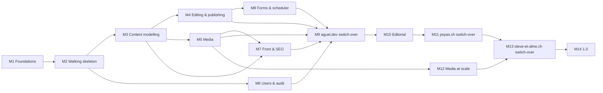

# Kami roadmap

The plan from an empty repository to the MVP as `docs/brief.md` defines it: **aguet.dev, psyao.ch and steve-et-aline.ch in production on Kami**, then 1.0. It is cut into fourteen milestones, each one ready to go as is into `/to-spec`.

Every decision here was taken in the wayfinder map ([Wayfinder: architecture and milestone roadmap](https://github.com/psyao/kami/issues/1)); the full record is the resolution of [Milestone roadmap](https://github.com/psyao/kami/issues/32#issuecomment-6427221046). This document restates it for use and adds no decision. The architecture it builds is in `docs/architecture.md`, the reasons in `docs/adr/`, the vocabulary in `GLOSSARY.md`.

## How the roadmap works

- **Capability milestones first, then the sites.** M1-M8 build Kami up to what aguet.dev needs, starting with a walking skeleton (one Content Type declared, edited in the admin, published and rendered at its Path, in two Locales) that later milestones widen layer by layer. Then each site gets one "what this site lacks" milestone and a separate Switch-over milestone, in the order **aguet.dev → psyao.ch → steve-et-aline.ch**. 1.0 comes last.
- **No leftovers milestone.** A feature no reference site uses lands in the milestone that builds its subsystem, so each subsystem's public API settles at once. A costly one goes to the latest milestone of its layer, never after steve-et-aline.ch's Switch-over.
- **Size.** One milestone is one spec readable in one sitting: about 8 to 15 tickets of a few hours to a day, each leaving the project stable, tested and documented. A spec that grows past that splits in two at `/to-spec`, without reopening this roadmap.
- **Working order is the numbering.** Dependencies below are the real ones; M6 and M12 could move earlier, but the numbering is the plan.
- **GitHub Milestones.** `/to-spec` creates one GitHub Milestone per roadmap milestone, named `M3 Content modelling` and so on. It holds the spec issue, its tickets and any `friction` or bug issue handled during it. Switch-over tickets live in `psyao/kami` too, under the site's Milestone; the site code stays in the site's private repository, which tickets name without pasting its content or URL inventories (ADR 0031).
- **One release per milestone.** A milestone closes with the merge of its release-please PR (0.x), so the playground and the sites pin a version. Kami is registered on Packagist at 0.1.0, the end of M1.

## Overview

| # | Milestone | Objective | Depends on |
| --- | --- | --- | --- |
| M1 | Foundations | The repository, its harness and its release machinery exist before any feature: tests, CI, docs skeleton, starter kit, playground, licence |
| M2 | Walking skeleton | One Content Type declared in code, edited in the admin, saved through `SaveEntry`, published at read time and rendered at its Path, in two Locales |
| M3 | Content modelling | The full content model: Field library, layout, relations, Taxonomies, Singletons and Global Sets, order and hierarchy, drift |
| M4 | Editing & publishing | Rich text and the editorial lifecycle: `Document`, Preview and Preview links, scheduling, Trash, duplication, admin conveniences |
| M5 | Media | The library and on-demand Conversions, accessible by construction |
| M6 | Users & audit | Roles and Permissions in full, MFA, anti-enumeration, Audit log |
| M7 | Front & SEO | What visitors and search engines receive: components, canonical URLs, SEO, sitemap and robots, error pages, page cache |
| M8 | Forms & scheduler | Simple Forms with deliveries, mail, the Tick and the queue |
| M9 | aguet.dev switch-over | `Import` in the core, then aguet.dev in production on Kami without content or URL loss | M4-M8 |
| M10 | Editorial (psyao.ch) | What a blog needs beyond aguet.dev: Blocks, internal links, Archives, Feeds, hierarchical URLs, Menus, Redirect management |
| M11 | psyao.ch switch-over | psyao.ch in production on Kami, WordPress retired |
| M12 | Media at scale (steve-et-aline.ch) | Media Folders, Focal point, galleries of hundreds of pictures within budget |
| M13 | steve-et-aline.ch switch-over | steve-et-aline.ch in production on Kami, WordPress retired |
| M14 | 1.0 | The stability promise starts |

## Acceptance criteria for every milestone

- CI green on all six jobs; the shared-hosting smoke covers the subsystem delivered.
- Public surface snapshot reviewed; any removed or changed line comes with a `!` commit.
- `docs/guide/` updated in the same pull request as the behaviour; `docs/reference/` fresh.
- New `x-kami::` components pass axe at level 3, new Kami admin pages at level 1.
- End-of-milestone ritual: the playground updated locally (`composer update` + `kami:install`), the milestone's features tried from the documentation only, `kami:doctor --strict` clean; every problem met becomes a `friction` issue. The playground is also deployed to Infomaniak staging, with `kami:doctor --strict` clean there, at M1 and at every milestone that touches rendering or switches a site over (M2, M5, M7, M9, M10, M11, M12, M13).
- Milestones that touch rendering (M2, M5, M7, M10, M12) end with `kami:bench` on Infomaniak staging, within the budgets of ADR 0021; M2 and M5, before `kami:bench` exists, measure the uncached TTFB with the loop in `docs/development.md`.
- Before the release, prose in `docs/guide/` and `README.md` that names the coming version ("Until 0.x") goes.
- The milestone closes with a merged release-please release.

## Milestones

MVP features are numbered in the order of the MVP section of `docs/comparatif-cms.md` (1 to 109). "(p)" marks a feature split by the triage: only its MVP part is placed here, the rest is in [Deferred to V1](#deferred-to-v1). "Also" lists what the milestone delivers beyond the MVP list: needs of the reference sites and constraints other decisions put on it.

### M1 Foundations

**Objective.** The repository, its harness and its release machinery exist before any feature: tests, CI, docs skeleton, starter kit, playground, licence.
**Depends on.** Nothing.

**MVP features (9).** 60 front asset pipeline (Vite in the starter kit) · 70 supported engines (CI matrix) · 73 configuration through `.env` · 80 dual mode (`KamiPlugin` in a host panel) · 89 security policy (`SECURITY.md`) · 95 dedicated CLI (`kami:install` and `kami:doctor` skeletons) · 99 developer documentation (skeleton) · 100 install through Composer and CLI · 102 shared-hosting compatibility (Apache + FPM smoke, then one step per subsystem in later milestones).

**Also.** Testbench + Workbench; suites `Kami`, `Install`, `Browser`, `Volume`; six CI jobs; lefthook; public surface snapshot; `docs/guide/` and generated `docs/reference/` with a freshness check; `development.md`; `.gitattributes` export-ignore and an archive test; Laravel Boost guideline and skill; `LICENSE.md` (MIT, ADR 0034); release-please, `CHANGELOG.md`, `UPGRADING.md`, supported-versions table; `composer licenses` job; `psyao/kami-starter`; `psyao/kami-playground`, local and deployed once to Infomaniak staging; `CLAUDE.md` completed.

**Acceptance.** A fresh `laravel new --using=psyao/kami-starter` installs Kami on SQLite and on the staging host with `kami:install`; every CI job runs on a pull request; `git archive` holds no design material; Swissreg, EUIPO and WIPO Madrid Monitor show no "KAMI" mark covering software (classes 9 and 42), or the name is changed first (retrospective §5.2); 0.1.0 is on Packagist.

### M2 Walking skeleton

**Objective.** One Content Type declared in code, edited in the admin, saved through `SaveEntry`, published at read time and rendered at its Path, in two Locales.
**Depends on.** M1.

**MVP features (29).** 1 content types in code · 9 field validation · 11 stable ids (ULID) · 14 a PHP class per Content Type · 30 drafts · 44 native multilingual · 45 field-level translation · 46 fallback Locale · 48 configurable permalinks (Prefix) · 49 slugs · 51 declarative custom routes (Kami routes as fallbacks) · 54(p) prefixed Locale URLs · 56 layouts and partials (minimal accessible starter layout) · 59 controller per template (`render()` hook) · 66 typed local API · 69 relational database · 71 transactions · 72 schemas in files · 75 deploy without content loss · 76 events (first Content events, allow-list arch test) · 85 query optimisation (`shouldBeStrict`, exact query counts) · 90 CSRF and XSS protection · 91 login throttling · 93 security headers and CSP · 96 generators (`kami:make:migration`) · 97 migrations · 104 responsive admin · 105 dark mode · 106 translated admin (`kami::` English + French, no-raw-key test).

**Also.** `administrator` Role only; tables `kami_entries`, `kami_translations`, `kami_type_<handle>`, `kami_paths`; `SecurityHeaders` with the fixed front CSP from the first rendered page; Filament's login throttling under test; `kami:install --email` granting the `administrator` Role to an existing User (0.2.x patch, #149).

**Acceptance.** A site declares a Content Type, generates its migration, edits an Entry in French and English, publishes it and reads it at `/slug` and `/en/slug`; a blank English Field falls back with a `lang` attribute; a Draft or a future `published_at` is a 404; front responses carry the CSP; the page stays within the query budget.

### M3 Content modelling

**Objective.** The full content model: Field library, layout, relations, Taxonomies, Singletons and Global Sets, order and hierarchy, drift.
**Depends on.** M2.

**MVP features (17).** 2 Field library · 3 repeaters and Field groups · 4 relations (`Entries` and `Terms` Fields, `kami_references`) · 5 taxonomies · 6 hierarchy (Parent, sibling reorder) · 7 reusable fieldsets · 8 Singletons, Global Sets and site settings · 10 conditional Fields · 12 layout Fields · 13 manual order · 15 quick create of a related Entry · 58 global view variables (`Footer::entry()`) · 74 environment sync (drift fails the deploy, `ContentMigrator`) · 77 custom Field types in code · 78 admin customisation in code (`EntryForm`, `EntryTable`) · 79 custom admin pages (guide only) · 98 seeders (install seeds missing Singleton and Global Set Entries, starter demo seeder).

**Also.** `kami:make:type`; a Byline is an `Entries` relation to a site-declared Person type, so it needs nothing more.

**Acceptance.** aguet.dev's three types and its Tag Taxonomy are declarable as in its research note (Home Singleton, ordered non-public collections, Tags in pick order); drift in either direction fails `kami:install`; the Volume suite runs nightly at 30,000 Entries.

### M4 Editing & publishing

**Objective.** Rich text and the editorial lifecycle: `Document`, Preview and Preview links, scheduling, Trash, duplication, admin conveniences.
**Depends on.** M3.

**MVP features (11).** 16 rich text (`Document`, allow-list including code marks and code blocks, `Document::fromHtml()`) · 19 live Preview · 33 scheduled publishing (next visibility change) · 34 Trash · 35 duplication · 36 shareable Preview links · 37 Creator and Last modifier · 38 admin search · 81 custom actions on content · 103 dashboard (three widgets, "Needs attention") · 107 bulk actions.

**Also.** `->inlineMarkdown()` on plain text Fields (aguet.dev); Locale switcher on the edit screen.

**Acceptance.** Preview of an unsaved form; a scheduled Translation appears at its date with no Tick; a revoked Preview link is a 404; Trash and restore work; rich text is normalised on save.

### M5 Media

**Objective.** The library and on-demand Conversions, accessible by construction.
**Depends on.** M3.

**MVP features (11).** 21 media library · 22 on-demand transformations · 23 WebP and AVIF (format family chosen by a real encode test) · 24 media metadata · 25 remote storage (originals on any disk) · 26(p) documents · 27 drag-and-drop and multiple upload · 29 srcset · 68 alt text required, with reminders · 84 lazy loading of images · 94 upload sanitisation (EXIF stripped, SVG under its own CSP).

**Also.** `Media` relation Field; Image Presets, including `kami-social`; `kami:media:warm`; protection of Media in use.

**Acceptance.** The first request of a Conversion writes a static file that Apache serves afterwards; AVIF is offered only where an encode succeeds; alt text is required on edit; originals are never public.

### M6 Users & audit

**Objective.** Roles and Permissions in full, MFA, anti-enumeration, Audit log.
**Depends on.** M2.

**MVP features (5).** 39 custom Roles · 40 granular Permissions · 41 MFA · 42 protection against user enumeration · 92 Audit log.

**Also.** `HasKamiRoles`.

**Acceptance.** MFA is enforced for `kami.users.manage`; the reset page never reveals whether an account exists; security and visibility events land in `kami_audit_events`.

### M7 Front & SEO

**Objective.** What visitors and search engines receive: components, canonical URLs, SEO, sitemap and robots, error pages, page cache.
**Depends on.** M3, M5.

**MVP features (11).** 53 redirect on slug change · 55 canonical URLs · 57 reusable view components (`x-kami::`) · 61 meta title and description · 62 Open Graph and Twitter cards · 63 XML sitemap · 64 robots.txt and noindex (`KAMI_INDEXABLE`) · 65 hreflang · 67(p) accessible components · 83 fragment and page cache (`Kami::remember()`, pre-boot reader, `kami:bench`) · 101 maintenance mode (the pre-boot reader respects it).

**Also.** Localised error pages; `Kami::routes(session: true)` and `Kami::sitemapUrls()` for host applications (ADR 0038).

**Acceptance.** aguet.dev's `HomePageTest` head assertions pass against the playground equivalent; a cached page is served without booting Laravel and goes stale after the next write or visibility change; robots and sitemap are correct with `KAMI_INDEXABLE` on and off.

### M8 Forms & scheduler

**Objective.** Simple Forms with deliveries, mail, the Tick and the queue.
**Depends on.** M4.

**MVP features (3).** 43 SMTP and mail transports · 86 task scheduler (Tick, `kami:tick:url`, `kami:announce-publications`, sitemap task) · 87 queue (drained within a budget).

**Also.** Simple Forms, for aguet.dev's contact form (ADR 0015); `kami:make:form`, `kami:forms:deliver`, `kami:forms:prune`; `kami:doctor` web snapshot.

**Acceptance.** A Form Submission is stored and delivered through SMTP from a Tick only (cron, URL or visits); nothing on the web path calls `exec` or `proc_open`.

### M9 aguet.dev switch-over

**Objective.** `Import` in the core, then aguet.dev in production on Kami without content or URL loss.
**Depends on.** M4, M5, M6, M7, M8.

**MVP features (1).** 88 heavy processing in the background (`Import`, `kami_import_keys`, `Import::submission()`, `SaveMedia` rollback cleanup, CLI imports).

**Also.** `app:import:velox` in the site's code; the Switch-over plan of [aguet.dev migration without URL loss](https://github.com/psyao/kami/issues/28#issuecomment-6426252928).

**Acceptance.** The four proofs of that plan pass on a local restore of production: count check, replay of the URL inventory, `HomePageTest` head assertions, visual suite byte-identical except the contact modal. aguet.dev runs in production. `kami_*` migrations are append-only from this release (ADR 0035). Removing the Velox tables is a later, separate release.

### M10 Editorial (psyao.ch)

**Objective.** What a blog needs beyond aguet.dev: Blocks, internal links, Archives, Feeds, hierarchical URLs, Menus, Redirect management.
**Depends on.** M9.

**MVP features (6).** 18 custom Blocks (Block pool, `Image`, click-to-load `Video`, `kami:make:block`) · 20 internal link picker (`kami://`) · 50 hierarchical URLs · 52 Redirect manager (`SaveRedirect`, query-string and key-only 410 Redirects) · 108 menu builder · 109 menu locations.

**Also.** Archives with cursor pagination; Term Archives; RSS Feeds; oEmbed videos through the `Video` Block.

**Acceptance.** psyao.ch's content model is declarable as in its research note; Feeds and Archives are valid; legacy query-string URLs answer 301 and key-only ones 410.

### M11 psyao.ch switch-over

**Objective.** psyao.ch in production on Kami, WordPress retired.
**Depends on.** M10.

**MVP features.** None.

**Also.** `app:import:wordpress` ported onto `Import`; the Switch-over plan of [psyao.ch and steve-et-aline.ch migration from WordPress](https://github.com/psyao/kami/issues/35#issuecomment-6426261236).

**Acceptance.** Each of the 558 former URLs replays to one 301 then a 200, or to its 410; psyao.ch runs in production; WordPress is unreachable, then archived after 30 days.

### M12 Media at scale (steve-et-aline.ch)

**Objective.** Media Folders, Focal point, galleries of hundreds of pictures within budget.
**Depends on.** M5.

**MVP features.** None.

**Also.** Media Folders; Focal point; an ordered `Media` relation at gallery size; a volume proof at 50,000 Media.

**Acceptance.** A 718-picture Gallery page stays within the query and weight budgets; changing the Focal point changes the Conversion URL; the Volume suite runs at 50,000 Media.

### M13 steve-et-aline.ch switch-over

**Objective.** steve-et-aline.ch in production on Kami, WordPress retired.
**Depends on.** M11, M12.

**MVP features.** None.

**Also.** Gallery Content Type and Block in the site's code; CLI import of the 720 MB of originals; the Switch-over plan of [psyao.ch and steve-et-aline.ch migration from WordPress](https://github.com/psyao/kami/issues/35#issuecomment-6426261236).

**Acceptance.** Each of the 1,233 former URLs replays; all 1,105 pictures are present; steve-et-aline.ch runs in production.

### M14 1.0

**Objective.** The stability promise starts.
**Depends on.** M13.

**MVP features.** None.

**Acceptance.** The three sites run in production on one 0.x release; 30 days pass without a breaking release; the public surface snapshot is reviewed; 1.0.0 is tagged (ADR 0035).

## Deferred to V1

The MVP features that no reference site needs and that pass the four-condition deferral rule (none of the three sites needs it, real cost, deferral closes no door, not from principles 1-3), as validated in [MVP/V1 deferral triage](https://github.com/psyao/kami/issues/6#issuecomment-6399224485) and confirmed by [Milestone roadmap](https://github.com/psyao/kami/issues/32#issuecomment-6427221046). A **door** is what the MVP already does so that the V1 feature lands without a data migration or a public API break.

| # | MVP feature | Door kept open in the MVP |
| --- | --- | --- |
| 17 | Block editor / page builder | One `Block` definition shared by rich text and a future Builder Field; Block data stored as typed JSON |
| 26(p) | Video and audio files (documents stay MVP) | Media typed by MIME family, not image-only |
| 28 | Chunked uploads | None needed: `kami:doctor` reports the effective upload limit, the admin rejects larger files with a clear error (host limit 300 MB; large originals go through the CLI) |
| 31, 32 | Revision history and restore | Every content write goes through one core action (`SaveEntry`); an Entry's whole value serialises |
| 47 | Site interface strings edited in the admin | None needed: a database loader would overlay `lang/` |
| 54(p) | Locale URLs by domain or subdomain (prefix stays MVP) | Current Locale resolved in one place; every URL generated through one routing API |
| 67(p) | Designed default front theme | Provided Blade components accessible (WCAG 2.2 AA) and a minimal accessible starter layout |
| 82 | Overridable or disableable core Resources | `KamiPlugin` registers its Resources by class name read from config |

## Coverage

The 109 MVP features of `docs/comparatif-cms.md` each have one destination: M1 9 + M2 29 + M3 17 + M4 11 + M5 11 + M6 5 + M7 11 + M8 3 + M9 1 + M10 6 = 103 placements, three of them split (26, 54, 67) with their other part in V1, plus six features wholly in V1 (17, 28, 31, 32, 47, 82). A number appears once per destination; checking it again means listing the numbers of this document against the MVP section of the comparatif.

## Changing the roadmap

Splitting a milestone at `/to-spec` needs no change here. Moving a feature between milestones, reordering milestones or deferring another MVP feature to V1 is a decision: record it on a GitHub issue first, then update this document in the same pull request, keeping the coverage complete.
